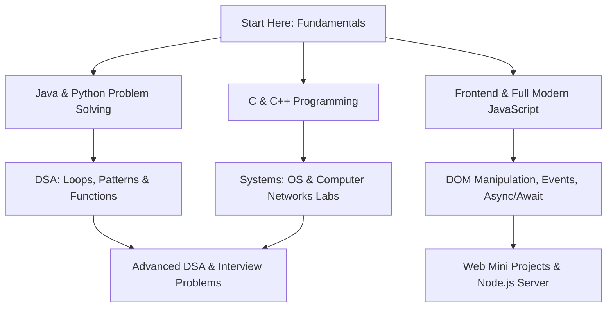

<div align="center">

# 🚀 Coding Practice & Computer Science Toolkit

**A comprehensive, modular collection of Data Structures, Algorithms, Systems Labs, Multi-Language Curricula, and Frontend Projects.**

[](LICENSE)
[](#-technology-stack)
[](#-repository-modules-deep-dive)
[](#)
[](#-how-to-contribute)

<p align="center">
  <a href="#-repository-overview">Overview</a> •
  <a href="#-repository-architecture">Structure</a> •
  <a href="#-repository-modules-deep-dive">Deep Dive</a> •
  <a href="#-how-to-run--execution-guide">How to Run</a> •
  <a href="#-learning-roadmap">Roadmap</a> •
  <a href="#-technology-stack">Tech Stack</a> •
  <a href="#-author-authorization--license">Author & Authorization</a>
</p>

> 🛡️ **Authorized & Maintained by [Lokanath Meher](https://github.com/lokanathmeher19)** • *Official Coding Practice & Computer Science Toolkit. Free to use for study, learning, and practice.*

---

</div>

## 📌 Repository Overview

Welcome to the **Coding Practice & Computer Science Toolkit**! This repository serves as a centralized, structured knowledge base covering everything from computer science fundamentals to production-grade modern web development.

Whether you are:
- Preparing for **technical coding interviews** (FAANG / Product-based companies),
- Completing university computer science coursework (**Operating Systems**, **Computer Networks**, **DAA / Practical Labs**),
- Mastering **Core Java**, **Data Structures & Algorithms (DSA)**, or **Python Problem Solving**,
- Leveling up in modern **Full-Stack JavaScript** (ES6+, DOM manipulation, Asynchronous Promises, Fetch API, OOP, Node.js), or
- Building interactive **Frontend Web Projects** (HTML5, CSS3, JavaScript),

This repository is organized into distinct, clean modules so that you can navigate, study, execute, and build upon any program with ease.

---

## 📂 Repository Architecture

```text
coding-practice/
│
├── 📁 c_lang/                     # C Language & Systems Engineering
│   ├── 📁 My Revision/            # Core C programming, pointers, math, arrays
│   ├── 📁 OS Lab/                 # CPU Scheduling (FCFS, SJF, RR), Page Replacement, Threads
│   └── 📁 Practical lab/          # Algorithms (Dijkstra, DFS, Kadane, LRU Cache, Sorts)
│
├── 📁 cpp_lang/                   # C++ Programming & Networking
│   ├── 📄 *.cpp                   # Arithmetic, strings, math & array logic
│   └── 📁 CN_Lab/                 # Computer Networks Lab (CRC, Bit/Char Stuffing, Framing)
│
├── 📁 DSA/                        # Data Structures & Algorithms
│   ├── 📁 Functions/              # Modular functions, recursion, factorials
│   ├── 📁 Loops/                  # Iteration algorithms, min-max, grade marking
│   ├── 📁 Parttens/               # 25+ Star, alphabet, hollow & diamond pattern programs
│   └── 📄 helloworld.cpp          # Starter verification program
│
├── 📁 Java/                       # Structured 8-Stage Core Java Curriculum
│   ├── 📁 01_Basic/               # Variables, basic I/O, arithmetic, scanner
│   ├── 📁 02_Conditions/          # If-else, switch, leap years, character types
│   ├── 📁 03_Loops/               # While/for loops, Fibonacci, prime, reverse numbers
│   ├── 📁 04_Parttens/            # Pyramid, diamond, Floyd & binary triangles
│   ├── 📁 05_Arrays/              # Linear search, min/max, copy, reverse, 2nd largest
│   ├── 📁 06_Strings/             # Palindromes, vowel counters, frequencies, substrings
│   ├── 📁 07_Methods/             # Methods, recursion, prime check, power methods
│   └── 📁 08_OOP/                 # Classes, objects, constructors, encapsulation
│
├── 📁 javascript/                 # Full Modern JavaScript Master Track
│   ├── 📁 Full_course-code/       # 100+ Chapter sequential deep-dive course (01 to 102)
│   ├── 📁 Arrays/                 # Array fundamentals & traversals
│   ├── 📁 Arrowfunctios/          # ES6 Arrow function syntax
│   ├── 📁 Dom_js/ & Dom_mani*/    # DOM querying, event handling & dynamic styling
│   ├── 📁 Highorder&callback/     # Higher-order functions & callback workflows
│   ├── 📁 Nxt moden js/           # ES6+ Destructuring, Rest & Spread operators
│   └── 📁 Loops/ & operators/     # Control flow, data types, operators
│
├── 📁 Python/                     # Python Problem Solving & Interview Prep
│   ├── 📁 basic_py/               # Dictionaries, exception handling, file I/O, list comp
│   ├── 📁 Operator&if_condtion/   # Password validators, comparison operations
│   ├── 📁 Nested-condition/       # Armstrong numbers, bills, denominations
│   ├── 📁 Loops/                  # Sum of N numbers, average calculations, shapes
│   ├── 📁 Number_character/       # Substrings, digit reversal, perimeter/area
│   ├── 📁 Stra_problem/           # Geometric shape generators & star repetition
│   └── 📁 Interview-Problem/      # High-frequency tech interview questions
│
├── 📁 Web/                        # Frontend UI Mini-Projects
│   ├── 📁 Calculator/             # Clean responsive digital calculator
│   ├── 📁 foodorder/              # Interactive food delivery interface
│   ├── 📁 News Page/              # Responsive news layout & cards
│   ├── 📁 Todolist/               # Dynamic task management web app
│   ├── 📁 codingcoverpage/        # Developer portfolio cover & hero page
│   └── 📁 chart_list/             # Modern chat interface messaging layout
│
├── 📄 .gitignore                  # Git ignore rules for compiled binaries & caches
└── 📄 Readme.md                   # Repository documentation & handbook
```

---

## 🔍 Repository Modules Deep Dive

### 1. ⚙️ C Programming & Systems Labs (`c_lang/`)
Comprehensive low-level programming covering fundamentals, Operating Systems theory, and algorithmic complexity.

* **`My Revision/` (Foundations)**:
  * Arithmetic operations, simple interest, Fahrenheit to Celsius, swap numbers.
  * Loops, prime number checks, square of numbers, reversing numbers.
  * Arrays: Element frequency, largest element, sum of N natural numbers.
* **`OS Lab/` (Operating Systems)**:
  * **CPU Scheduling**: First-Come First-Served (`Fcfs.c`), Shortest Job First (`Sjf.c`), Round Robin with quantum scheduling (`Roundrobin.c`).
  * **Memory Management**: First-In-First-Out Page Replacement (`FIFO Page-Replacement.c`).
  * **Concurrency**: POSIX multithreading implementation in C (`implement_c_threading.c`).
* **`Practical lab/` (Data Structures & Algorithms - DAA)**:
  * **Graph Algorithms**: Dijkstra's Single Source Shortest Path (`Dijikrta.c`), Depth-First Search (`Dfs.c`).
  * **Optimization & Greedy**: Fractional Knapsack (`knapsack_greedy.c`), Minimum Coin Change (`minimucoins.c`).
  * **Dynamic Programming & Arrays**: Kadane's Algorithm for Maximum Subarray Sum (`kadane-algo.c`), LRU Cache replacement (`LRUchace.c`), Spiral Matrix Traversal (`spiralmatrix.c`).
  * **Sorting & Empirical Analysis**: Merge Sort with execution timer (`merge_sort-time.c`), Quick Sort with benchmarking (`quick_sort_time.c`), Selection Sort (`selection_sort_time.c`).
  * **Recursion**: Classic recursive Tower of Hanoi puzzle (`Tower of Hanoi.c`).

---

### 2. ⚡ C++ & Computer Networks (`cpp_lang/`)
* **Core C++**:
  * Arithmetic operations, floating point multiplication/division, division of large numbers.
  * String manipulations, character appending, string concatenation, vowel counting.
  * Array summation and multiplication tables.
* **`CN_Lab/` (Computer Networks Lab)**:
  * **Error Detection**: Cyclic Redundancy Check (`Crc.cpp`).
  * **Data Link Framing**: Bit Stuffing and Character Stuffing implementations (`EXP_1.cpp`, `Exp_1.1.cpp`, `exp1.2.cpp`, `exp1.3.cpp`).
  * **Network Protocols**: Network simulation and experiment models (`Exp_6.cpp`).

---

### 3. 🧩 Data Structures & Algorithms (`DSA/`)
Specialized problem-solving programs focusing on algorithmic patterns and spatial reasoning:
* **`Parttens/` (25+ Pattern Implementations)**:
  * Classic Star Triangles, Inverted Triangles, Hollow Squares, Diamond Patterns.
  * Number Pyramids, Binary Matrices, Alphabet Sequences, and Backward Letter Patterns.
* **`Loops/`**:
  * Min-max identification, age boundary checks, grade calculators, character casing.
* **`Functions/`**:
  * Factorial computation with recursion, modular driver functions, summation of 1 to N.

---

### 4. ☕ Core Java Curriculum (`Java/`)
An 8-stage pedagogical track designed for complete mastery of Core Java:

| Stage | Module Directory | Key Concepts & Topics Covered |
| :---: | :--- | :--- |
| **01** | [`01_Basic/`](file:///c:/Users/HP/OneDrive/Desktop/A/Studywork/coding-practice/Java/01_Basic) | JVM basics, console I/O, Scanner, Arithmetic (+, -, *, /), variable swapping, user input. |
| **02** | [`02_Conditions/`](file:///c:/Users/HP/OneDrive/Desktop/A/Studywork/coding-practice/Java/02_Conditions) | If-else branching, switch-case, Leap Year, Largest of 3, Grade calculation, Vowel/Consonant, Calculator. |
| **03** | [`03_Loops/`](file:///c:/Users/HP/OneDrive/Desktop/A/Studywork/coding-practice/Java/03_Loops) | While, For, Do-While, Fibonacci series, Factorial, Prime number check, Palindrome numbers, Digit sum. |
| **04** | [`04_Parttens/`](file:///c:/Users/HP/OneDrive/Desktop/A/Studywork/coding-practice/Java/04_Parttens) | Right triangles, Inverted pyramids, Floyd's triangle, Binary triangle, Diamond pattern, Number triangles. |
| **05** | [`05_Arrays/`](file:///c:/Users/HP/OneDrive/Desktop/A/Studywork/coding-practice/Java/05_Arrays) | 1D Arrays, Linear Search, Min/Max finding, Second Largest, Array reversal, Copying arrays, Average. |
| **06** | [`06_Strings/`](file:///c:/Users/HP/OneDrive/Desktop/A/Studywork/coding-practice/Java/06_Strings) | String immutability, Palindrome check, Vowel counting, Word count, Character frequency, Substrings. |
| **07** | [`07_Methods/`](file:///c:/Users/HP/OneDrive/Desktop/A/Studywork/coding-practice/Java/07_Methods) | Static & instance methods, parameters, return values, recursive factorials, prime checking methods. |
| **08** | [`08_OOP/`](file:///c:/Users/HP/OneDrive/Desktop/A/Studywork/coding-practice/Java/08_OOP) | Classes, objects, memory allocation, constructors, encapsulation, student details management. |

---

### 5. 🌐 Modern JavaScript Master Track (`javascript/`)
A multi-tier JavaScript collection featuring both modular standalone experiments and a **100+ Chapter Full Course**:

* **Core Language Concepts**:
  * `02` - `15`: Variables (`var`, `let`, `const`), Primitive Types, Conditionals, Loops, Strings & String Methods.
  * `16` - `22`: Arrays, Array Methods (`push`, `pop`, `splice`, `slice`), `map()`, `filter()`, `reduce()`.
* **Browser DOM & BOM**:
  * `23` - `35`: Browser JS, `console` APIs, `alert`/`prompt`/`confirm`, Window object, Walking the DOM, Children, Siblings, Parents.
  * `36` - `45`: `querySelector`, `querySelectorAll`, `matches`, `closest`, `contains`, `innerHTML`, `outerHTML`, HTML attributes, Element Insertion methods, `classList`.
* **Events & Async Programming**:
  * `46` - `51`: `setTimeout`, `setInterval`, Browser Events, `addEventListener`, Event propagation.
  * `52` - `65`: Callbacks, Callback Hell, Promises, `.then()` / `.catch()`, Promise Chaining, Promise API (`Promise.all`, `Promise.race`), `async`/`await`, `try`/`catch`, Custom Error Objects, `finally`.
* **Network & Web Storage**:
  * `66` - `73`: Fetch API, HTTP POST requests, JavaScript Cookies, `localStorage`, `sessionStorage`.
* **Object-Oriented JavaScript**:
  * `74` - `85`: Prototypes & Prototypal Inheritance (`__proto__`), Classes, Constructors, `extends`, Method Overriding, `super()`, Static Methods, Getters & Setters.
* **Advanced JS & Modern Tooling**:
  * `86` - `94`: IIFE, Destructuring Assignment, Spread Syntax, Scopes, Hoisting, Closures, Advanced Arrow Functions.
  * `95` - `102`: Node.js server basics, npm package integration, ES6 Modules (`import`/`export`), Regular Expressions (`regex`), Event Loop, Real-world **PDF Merger** project.

---

### 6. 🐍 Python Problem Solving & Interview Prep (`Python/`)
* **`basic_py/`**: Dictionaries, Exception Handling (`try-except`), File Handling (`read`/`write`), Mean/Average, List Comprehension (`BONUS.py`).
* **`Operator&if_condtion/`**: Password validity check, logical and bitwise operators, string character comparisons.
* **`Nested-condition/`**: Armstrong number validation, Currency denomination calculator, Electricity billing slabs, Calendar day determination.
* **`Loops/`**: While loop mechanics, Sum of N numbers, average calculators, solid rectangles, right-angled triangles.
* **`Number_character/`**: Substring extractions, character position comparisons, digit reversals, shape perimeter/area checks.
* **`Stra_problem/`**: Triangle repetitions, square grids, custom star patterns.
* **`Interview-Problem/`**:
  * Anagram verification (`anagram_check.py`).
  * Missing number in array from $1$ to $N$ (`missing_number.py`).
  * Reverse words in a sentence (`reverse_words.py`).
  * Count vowels and consonants in a string (`vowel_consonant_count.py`).
  * Rest parameters and variable argument handling (`restparameter.py`).

---

### 7. 🎨 Frontend Web Projects (`Web/`)
Clean, semantic, responsive frontend mini-projects built with pure HTML5, CSS3, and JavaScript:

| Project | Folder | Preview & Features |
| :--- | :--- | :--- |
| **Interactive Calculator** | [`Web/Calculator/`](file:///c:/Users/HP/OneDrive/Desktop/A/Studywork/coding-practice/Web/Calculator) | Fully functional arithmetic calculator with responsive buttons, real-time input screen, and clear/evaluate actions. |
| **Food Ordering UI** | [`Web/foodorder/`](file:///c:/Users/HP/OneDrive/Desktop/A/Studywork/coding-practice/Web/foodorder) | Modern food item catalog with cards, imagery styling, pricing tags, and call-to-action buttons. |
| **News Portal** | [`Web/News Page/`](file:///c:/Users/HP/OneDrive/Desktop/A/Studywork/coding-practice/Web/News%20Page) | Newspaper/magazine layout with headline sections, featured stories, grid layout, and typography. |
| **To-Do List App** | [`Web/Todolist/`](file:///c:/Users/HP/OneDrive/Desktop/A/Studywork/coding-practice/Web/Todolist) | Clean task organizer interface designed for daily task planning and checklists. |
| **Coding Portfolio Cover** | [`Web/codingcoverpage/`](file:///c:/Users/HP/OneDrive/Desktop/A/Studywork/coding-practice/Web/codingcoverpage) | Developer landing hero page with headline typography, social badge layout, and CTA buttons. |
| **Chat Interface UI** | [`Web/chart_list/`](file:///c:/Users/HP/OneDrive/Desktop/A/Studywork/coding-practice/Web/chart_list) | Responsive chat bubble layout displaying incoming and outgoing conversation threads. |

---

## 💻 How to Run & Execution Guide

### Prerequisites
Before running any code, verify you have the appropriate runtime or compiler installed:
- **C / C++**: `gcc` / `g++` (via MinGW for Windows, Xcode command line tools for macOS, or `build-essential` for Linux)
- **Java**: JDK 17 or higher (`javac` & `java`)
- **Python**: Python 3.8 or higher (`python` / `python3`)
- **JavaScript / Node.js**: Node.js 18 or higher (`node`)
- **Web**: Any modern web browser (Chrome, Edge, Firefox) or VS Code **Live Server** extension

---

### 1. Running C Programs
Compile with GCC and run the generated executable:
```bash
# Navigate to the target directory
cd "c_lang/OS Lab"

# Compile with gcc
gcc -O2 Fcfs.c -o Fcfs

# Execute
# On Windows:
.\Fcfs.exe
# On macOS/Linux:
./Fcfs
```

### 2. Running C++ Programs
Compile with G++:
```bash
# Navigate to DSA or cpp_lang
cd "DSA/Functions"

# Compile with g++
g++ -O2 Factorial.cpp -o Factorial

# Execute
# On Windows:
.\Factorial.exe
# On macOS/Linux:
./Factorial
```

### 3. Running Java Programs
Compile with `javac` and run with `java`:
```bash
# Navigate to the target module
cd "Java/03_Loops"

# Compile the .java file
javac FibonacciSeries.java

# Run the compiled bytecode (.class)
java FibonacciSeries
```

### 4. Running Python Programs
Run directly via the Python interpreter:
```bash
# Example 1: Run an interview problem
python "Python/Interview-Problem/missing_number.py"

# Example 2: Run a loop practice problem
python "Python/Loops/Avg-n-Num.py"

# Example 3: Run list comprehension bonus
python "Python/basic_py/BONUS.py"
```

### 5. Running JavaScript & Node.js Scripts
For console and server-side JS scripts:
```bash
# Run standalone script with Node.js
node "javascript/Nxt moden js/deconstuctexample.js"

# Run a chapter from the full course
node "javascript/Full_course-code/54Promise/index.js"
```

For browser-based JS lessons:
* Simply open the corresponding `index.html` file in your favorite web browser, open the DevTools Console (`F12` or `Ctrl+Shift+I`), and observe the live outputs.

### 6. Previewing Web Projects
* **Option 1 (Direct)**: Double-click any `index.html` file (e.g. `Web/Calculator/index.html` or `Web/foodorder/index.html`) to launch it in your browser.
* **Option 2 (VS Code Live Server)**: Right-click `index.html` in VS Code and choose **"Open with Live Server"**.
* **Option 3 (Python Local Server)**:
  ```bash
  cd Web
  python -m http.server 8000
  # Then open http://localhost:8000 in your browser
  ```

---

## 🗺️ Learning Roadmap

If you are new to the repository or planning a structured study session, follow this recommended sequence:



1. **Phase 1: Foundations**:
   - Begin with [`Java/01_Basic`](file:///c:/Users/HP/OneDrive/Desktop/A/Studywork/coding-practice/Java/01_Basic) and [`Python/basic_py`](file:///c:/Users/HP/OneDrive/Desktop/A/Studywork/coding-practice/Python/basic_py).
   - Get comfortable with variables, operators, conditionals, and standard I/O.
2. **Phase 2: Logic Building & Patterns**:
   - Practice loop constructs in [`DSA/Loops`](file:///c:/Users/HP/OneDrive/Desktop/A/Studywork/coding-practice/DSA/Loops) and [`Java/03_Loops`](file:///c:/Users/HP/OneDrive/Desktop/A/Studywork/coding-practice/Java/03_Loops).
   - Master nested loops by tackling the 25+ pattern challenges in [`DSA/Parttens`](file:///c:/Users/HP/OneDrive/Desktop/A/Studywork/coding-practice/DSA/Parttens).
3. **Phase 3: Core Data Structures & OOP**:
   - Master Array algorithms in [`Java/05_Arrays`](file:///c:/Users/HP/OneDrive/Desktop/A/Studywork/coding-practice/Java/05_Arrays) and String algorithms in [`Java/06_Strings`](file:///c:/Users/HP/OneDrive/Desktop/A/Studywork/coding-practice/Java/06_Strings).
   - Study Object-Oriented Programming principles in [`Java/08_OOP`](file:///c:/Users/HP/OneDrive/Desktop/A/Studywork/coding-practice/Java/08_OOP) and [`javascript/Full_course-code/76classesandobjects`](file:///c:/Users/HP/OneDrive/Desktop/A/Studywork/coding-practice/javascript/Full_course-code/76classesandobjects).
4. **Phase 4: Systems Engineering & Networking**:
   - Dive into CPU scheduling and memory management in [`c_lang/OS Lab`](file:///c:/Users/HP/OneDrive/Desktop/A/Studywork/coding-practice/c_lang/OS%20Lab).
   - Explore error detection (CRC) and framing in [`cpp_lang/CN_Lab`](file:///c:/Users/HP/OneDrive/Desktop/A/Studywork/coding-practice/cpp_lang/CN_Lab).
   - Solve DAA algorithms (Dijkstra, Knapsack, Kadane's) in [`c_lang/Practical lab`](file:///c:/Users/HP/OneDrive/Desktop/A/Studywork/coding-practice/c_lang/Practical%20lab).
5. **Phase 5: Modern Web & Asynchronous JS**:
   - Progress through the asynchronous master series in [`javascript/Full_course-code`](file:///c:/Users/HP/OneDrive/Desktop/A/Studywork/coding-practice/javascript/Full_course-code) (Promises, `async`/`await`, Fetch API).
   - Experiment with real web applications in [`Web/`](file:///c:/Users/HP/OneDrive/Desktop/A/Studywork/coding-practice/Web).
6. **Phase 6: Interview Preparation**:
   - Tackle high-frequency coding questions in [`Python/Interview-Problem`](file:///c:/Users/HP/OneDrive/Desktop/A/Studywork/coding-practice/Python/Interview-Problem).

---

## 🛠️ Technology Stack

| Domain | Languages / Tools | Purpose / Highlights |
| :--- | :--- | :--- |
| **Systems & Algorithms** | C (C99/C11), C++ (C++17/20) | High performance, memory management, OS scheduling, networking protocols. |
| **Object-Oriented Programming** | Java (JDK 17+) | Platform independence, robust type safety, structured modular OOP track. |
| **Scripting & Rapid Prototyping** | Python 3 | Expressive syntax, list comprehensions, interview algorithms, problem solving. |
| **Full-Stack Scripting** | JavaScript (ES6+), Node.js | Modern asynchronous web development, DOM APIs, event-driven architectures. |
| **Frontend UI Design** | HTML5, CSS3, Flexbox, Grid | Clean, responsive mini-projects, CSS layout paradigms, UI design. |
| **Development & Build** | Git, GitHub, VS Code | Version control, clean `.gitignore` tracking, modern coding workflow. |

---

## 🤝 How to Contribute

Contributions, bug reports, and optimizations are welcome! If you would like to contribute:

1. **Fork the Repository**: Click on the `Fork` button at the top right of this page.
2. **Clone your Fork**:
   ```bash
   git clone https://github.com/lokanathmeher19/coding-practice.git
   cd coding-practice
   ```
3. **Create a Feature Branch**:
   ```bash
   git checkout -b feature/new-algorithm-solution
   ```
4. **Commit your Changes**:
   * Follow consistent naming conventions (e.g. `PascalCase` for Java classes, `snake_case` or descriptive names for Python/C).
   * Ensure code includes clear comments explaining the approach and time/space complexity.
   * Avoid committing compiled binaries (`.exe`, `.class`, etc.). The repository's [`.gitignore`](file:///.gitignore) is configured to keep the repository clean.
   ```bash
   git commit -m "Add Binary Search algorithm in Java"
   ```
5. **Push to GitHub & Open a Pull Request**:
   ```bash
   git push origin feature/new-algorithm-solution
   ```

---

## 👤 Author, Authorization & License

* **Author & Maintainer**: **Lokanath Meher**
* **GitHub**: [@lokanathmeher19](https://github.com/lokanathmeher19)
* **Email**: [meherlokanath314@gmail.com](mailto:meherlokanath314@gmail.com)
* **Authorization & Usage**: This repository is created, authored, and authorized by **Lokanath Meher**. All code, solutions, and implementations are officially authorized and open for educational use, technical interview preparation, and personal coding practice under the MIT License.

Distributed under the **MIT License**. Feel free to use, study, and adapt this repository for your learning and educational purposes.

<div align="center">
  <sub>⭐ If you find this repository helpful, consider giving it a star on GitHub! Happy Coding! ⭐</sub>
</div>